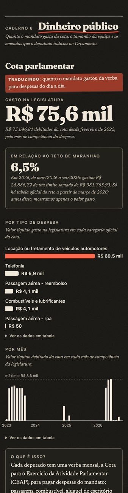
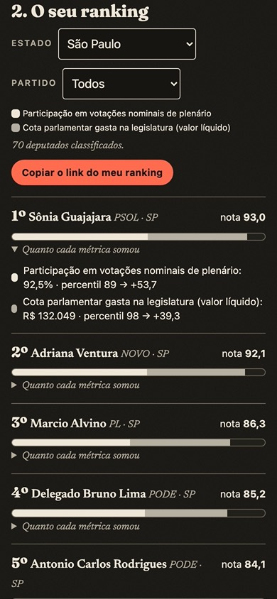
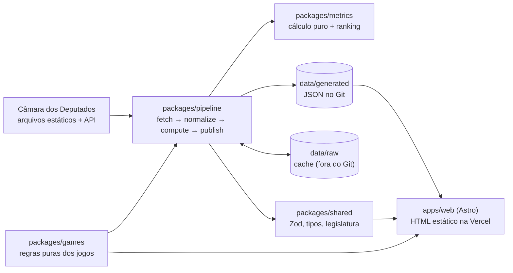

<h1 align="center">Extrapolar</h1>

<p align="center">
  <strong>O que os deputados federais estão fazendo, em números e fatos.</strong><br />
  Dados oficiais da Câmara e da CGU, explicados em poucas linhas, para quem não acompanha política. Sem ranking oficial e sem adjetivo, com jogos para conhecer a Câmara.
</p>

<p align="center">
  
  
  
  
  <a href="https://github.com/Dustyluc123/Extrapolar/actions/workflows/ci.yml"></a>
  
</p>

<p align="center">
  
</p>

---

## Índice

- [O que é](#o-que-é)
- [Princípios](#princípios)
- [Funcionalidades](#funcionalidades)
- [Telas](#telas)
- [Arquitetura](#arquitetura)
- [Tecnologias](#tecnologias)
- [Estrutura de pastas](#estrutura-de-pastas)
- [Como rodar](#como-rodar)
- [Dados e metodologia](#dados-e-metodologia)
- [Testes e verificações](#testes-e-verificações)
- [Deploy](#deploy)
- [Roadmap](#roadmap)
- [Sobre mim](#sobre-mim)

## O que é

Sites como Ranking dos Políticos, Radar do Congresso e FiscalizaJá falam com quem já se interessa por política. O **Extrapolar** quer falar com quem **não** se interessa: jovens que nunca abriram o site da Câmara, mas querem entender em poucos minutos o que o deputado do seu estado anda fazendo.

O visual lembra um **jornal impresso antigo** (papel, tinta, manchetes, réguas), mas é limpo, moderno e feito primeiro para o celular. Cada número aparece grande, como manchete, sempre acompanhado de fonte, data de atualização e explicação do que ele mede e do que **não** mede.

## Princípios

1. **Neutralidade.** Números e fatos, nunca julgamentos. Nada de "melhor", "pior", "corrupto", "herói". Quem conclui é o leitor.
2. **Todo número é verificável.** Fonte oficial, data da última atualização e link para a metodologia ao lado de cada indicador.
3. **Nunca inventar dados.** O que não vem de fonte oficial fica como "sem dado" (`null`), nunca como zero.
4. **Custo perto de zero.** Site estático, sem servidor ligado; os dados são atualizados por uma tarefa agendada.
5. **Contexto.** Toda métrica documenta suas limitações.

O site **nunca define um ranking**: a lista de deputados é sempre em ordem alfabética. A única lista ordenada é o **Monte seu ranking**, em que quem escolhe métricas, pesos e direção é o leitor.

## Funcionalidades

- [x] Capa com os **513 deputados em exercício**, busca por nome (ignora acentos) e filtros por estado e partido, com o filtro salvo na URL para compartilhar
- [x] Ficha de cada deputado (`/deputados/[id]`) com **resumo em números** (6 números fixos, os mesmos para todos) e **7 cadernos**, como um jornal:
  - **Plenário:** participação em votações nominais, presença em sessões deliberativas, alinhamento com a orientação do partido e do Governo
  - **Comissões:** comissões e cargos (linha do tempo), presença nas reuniões em que é titular, audiências e eventos realizados a pedido
  - **Projetos e leis:** projetos por tipo (autor principal × coautoria), o que aconteceu com eles (taxa de conversão em norma), temas oficiais, pareceres como relator
  - **Fiscalização:** requerimentos de informação, propostas de fiscalização, convocações de ministros (tipo oficial) e indicações ("sugestões ao governo")
  - **Voz:** discursos por ano e por fase da sessão (atualização semanal)
  - **Dinheiro público:** cota parlamentar (por mês, categoria e, onde há tabela oficial, em relação ao teto), equipe do gabinete e emendas individuais (CGU)
  - **Articulação e perfil:** frentes parlamentares, cargos (Mesa, comissões, lideranças), profissões e ocupações declaradas
- [x] Toda métrica com número, gráfico, **"Traduzindo:"**, **"O que é isso?"**, **"O que este número não mostra"**, fonte, data e link para a metodologia
- [x] **"Sem dado" com motivo**, nunca zero no lugar de dado ausente
- [x] Gráficos gerados no build (SVG e HTML), sem JavaScript, com tabela dos mesmos dados
- [x] **Glossário** (`/glossario`) com 42 termos, no estilo "Classificados", linkado a partir das fichas
- [x] Página de **metodologia** gerada a partir de [`docs/METODOLOGIA.md`](docs/METODOLOGIA.md), com o que ficou de fora e por quê
- [x] Cabeçalho de jornal com a **data da edição**, **edição noturna** (modo escuro), fotos em **meio-tom** só em CSS
- [x] **Jogos** (`/jogos`), com sequência, estatísticas e compartilhar em quadradinhos sem a resposta:
  - **Dle do seu estado:** adivinhar o deputado do dia entre os do estado, com pistas factuais (partido, condição, estreia, nascimento, comissões, projetos)
  - **Placar:** ler uma votação real e chutar como votou a maioria do seu estado e a porcentagem de Sim
  - **Vote você também:** votar em 10 votações recentes e ver com quais deputados (e orientações de partido) votou igual
  - **Seja deputado:** a votação mais recente — vote e veja o resultado e quem votou o quê
  - Só votações **nominais de mérito** do plenário, separadas das de procedimento por um método documentado e conferido numa amostra (lista em `/jogos/votacoes`); o voto do jogador fica só no navegador
- [x] **Monte seu ranking** (`/ranking`): o leitor escolhe métricas, pesos (0 a 5) e se o valor maior ou menor sobe; percentil, contribuição de cada métrica, "sem dado" à parte e link compartilhável. Nada vem marcado
- [x] Acessível: contraste AA nos dois temas, navegação por teclado, textos alternativos, verificação automática com axe-core
- [x] Pipeline diário no GitHub Actions: baixa, valida com Zod, calcula e publica; se algo vier diferente do esperado, **para sem publicar**

## Telas

| Capa no celular                                   | Resumo em números da ficha                                    | Caderno de dinheiro, edição noturna                                              |
| ------------------------------------------------- | ------------------------------------------------------------- | -------------------------------------------------------------------------------- |
|  |  |  |

| Jogo: Dle do seu estado                                            | Monte seu ranking, edição noturna                                            |
| ------------------------------------------------------------------ | ---------------------------------------------------------------------------- |
|  |  |

## Arquitetura

O site nunca fala com a Câmara. Um pipeline agendado lê os dados abertos, valida, calcula e grava JSON no repositório; a Vercel builda o site estático a partir desses arquivos.



Princípios que guiaram o código:

- **Cálculo separado do mundo.** `packages/metrics` só tem funções puras (sem rede, disco ou relógio) e é todo testado. Rede, cache e orquestração ficam em `packages/pipeline`.
- **Validação na entrada e na saída.** Esquemas Zod para o formato da Câmara e para os JSON gerados. Campo diferente do esperado: o pipeline falha com o caminho exato do problema e não publica. O site valida de novo no build.
- **Educado com a Câmara.** Arquivos estáticos para cargas grandes; na API, no máximo 2 requisições simultâneas, pausa entre elas e novas tentativas com espera crescente. Downloads ficam em cache.
- **Repositório trocável.** As páginas pedem dados a `DeputyRepository`. Hoje a implementação lê JSON; um banco PostgreSQL pode entrar depois sem mudar as páginas.
- **Legislatura configurável.** Trocar da 57ª para a 58ª é mudar uma constante em `packages/shared/src/legislature.ts`.

Mais detalhes em [`docs/ARQUITETURA.md`](docs/ARQUITETURA.md) e nas decisões em [`docs/decisoes/`](docs/decisoes/).

## Tecnologias

| Camada      | Ferramenta                               | Por quê                                                                |
| ----------- | ---------------------------------------- | ---------------------------------------------------------------------- |
| Linguagem   | TypeScript (tudo)                        | Tipos e esquemas compartilhados entre pipeline e site                  |
| Site        | Astro 6, HTML estático                   | Site quase todo conteúdo: rápido, barato, sem JavaScript desnecessário |
| Estilo      | Tailwind CSS 4, Fraunces e Newsreader    | Tokens próprios de papel e tinta; fontes variáveis servidas pelo site  |
| Validação   | Zod 4                                    | Tudo que vem da Câmara e da CGU é validado antes de entrar no projeto  |
| Gráficos    | Componentes Astro (SVG e HTML) no build  | Zero JavaScript no navegador; leve no celular                          |
| Interação   | Ilhas React só nos jogos e no ranking    | O resto do site continua sem JavaScript de framework                   |
| Dados       | JSON gerado no Git (sem banco na Fase 0) | Zero infraestrutura; histórico dos dados no próprio repositório        |
| Agendamento | GitHub Actions (cron diário)             | Atualização dos dados sem servidor ligado                              |
| Hospedagem  | Vercel                                   | Deploy automático a cada commit de dados                               |
| Monorepo    | pnpm workspaces + Turborepo              | Site, pipeline e pacotes no mesmo repositório                          |
| Qualidade   | Vitest, ESLint, Prettier, axe-core       | Testes de cálculo e validação, lint, formatação e acessibilidade       |

## Estrutura de pastas

```
Extrapolar/
├── apps/
│   └── web/                        # Site em Astro
│       └── src/
│           ├── pages/              # index, deputados/[id], jogos/*, ranking, metodologia, glossario, sobre
│           ├── components/
│           │   ├── ficha/          # Caderno, bloco de métrica, resumo em números, "sem dado"
│           │   ├── charts/         # Barras, colunas e linha do tempo (gerados no build)
│           │   ├── ui/             # Manchete, régua, selo, número-manchete, linha de fonte
│           │   ├── deputado/       # Linha da lista, filtros, foto em meio-tom, seções da ficha
│           │   ├── games/          # Ilhas React dos quatro jogos
│           │   ├── ranking/        # Ilha do "Monte seu ranking"
│           │   └── layout/         # Cabeçalho (masthead), seletor de edição, rodapé
│           ├── layouts/            # Layout base
│           ├── lib/                # Leitura dos dados gerados, formatação (datas, %), estados
│           └── styles/             # Tokens, fontes, textura de papel
├── packages/
│   ├── shared/                     # Legislatura, esquemas Zod (entrada e saída), tipos, repositório
│   ├── metrics/                    # Funções puras de cada indicador e do ranking
│   ├── games/                      # Regras puras dos jogos (dia de Brasília, sorteio, comparação, pontos)
│   └── pipeline/                   # Rede, cache, normalização, orquestração
│       └── src/
│           ├── sources/            # camara-api.ts, camara-arquivos.ts
│           ├── normalize/          # Períodos em exercício, deputados, votações
│           ├── steps/              # fetch → normalize → compute → publish
│           └── lib/                # HTTP com novas tentativas, cache, horário de Brasília
├── data/
│   ├── raw/                        # Cache dos downloads (fora do Git)
│   └── generated/                  # deputados.json, deputados/{id}.json, metricas.json, frentes.json, meta.json, jogos/
├── content/resumos/                # Resumos de votações em linguagem simples (escritos à mão, opcionais)
├── docs/
│   ├── ARQUITETURA.md  METODOLOGIA.md  DESIGN.md  FONTES.md  DEPLOY.md
│   ├── decisoes/                   # ADRs (0001-astro.md ...)
│   └── briefing-fase*.md           # Briefings de cada fase
├── scripts/                        # Neutralidade, acessibilidade, capturas de tela
├── .github/workflows/              # ci.yml (a cada push) e pipeline.yml (diário)
├── CLAUDE.md                       # Guia para o Claude Code
└── LICENSE
```

## Como rodar

### Pré-requisitos

- [Node.js](https://nodejs.org/) 22.12 ou mais novo
- [pnpm](https://pnpm.io/) 10 (o jeito mais fácil: `corepack enable`)

### Passo a passo

```bash
# 1. Instale as dependências
pnpm install

# 2. Suba o site (os dados já vêm no repositório, em data/generated)
pnpm dev
```

Abra **http://localhost:4321**.

Para atualizar os dados com o que a Câmara publicou hoje:

```bash
pnpm pipeline              # usa o cache de data/raw quando ainda vale (20 horas)
pnpm pipeline -- --refresh # ignora o cache e baixa tudo de novo (~1,3 GB; 15 a 20 minutos, quase tudo nos discursos)
```

### Scripts

| Comando                   | O que faz                                                                          |
| ------------------------- | ---------------------------------------------------------------------------------- |
| `pnpm dev`                | Site com recarga automática                                                        |
| `pnpm pipeline`           | Baixa, valida e calcula os dados da Câmara e grava `data/generated`                |
| `pnpm build`              | Gera o site estático em `apps/web/dist`                                            |
| `pnpm test`               | Todos os testes                                                                    |
| `pnpm typecheck`          | Confere os tipos (inclusive `astro check`)                                         |
| `pnpm lint`               | ESLint                                                                             |
| `pnpm format`             | Formata o código com Prettier (`format:check` só confere)                          |
| `pnpm check:neutralidade` | Procura palavras de julgamento nos textos do site (só avisa, nunca quebra)         |
| `pnpm check:a11y`         | Acessibilidade com axe-core e teste da busca pelo teclado (\*)                     |
| `pnpm check:a11y:jogos`   | Acessibilidade dos jogos e do ranking depois de jogar (\*)                         |
| `pnpm screenshots`        | Capturas no celular e no desktop, claro e escuro, e alerta de rolagem lateral (\*) |

(\*) Precisam do site rodando (`pnpm build && pnpm --filter @extrapolar/web preview`) e do Google Chrome instalado.

## Dados e metodologia

Quase todos os números vêm dos [Dados Abertos da Câmara dos Deputados](https://dadosabertos.camara.leg.br/) (arquivos estáticos diários e, quando não há arquivo, a API). As emendas vêm do [Portal da Transparência](https://portaldatransparencia.gov.br/emendas) da CGU. Cada fonte, com link, formato conferido e condições de uso, está em [`docs/FONTES.md`](docs/FONTES.md).

Algumas regras que valem para tudo:

- Só a legislatura atual (57ª) e só os períodos em que cada deputado esteve em exercício (licenças e suplências respeitadas).
- Votações: só as **nominais** do **plenário** (as únicas com voto de cada deputado registrado).
- Projetos: **autor principal** (primeiro signatário) separado de coautoria e de assinaturas de apoio.
- Dinheiro: teto da cota só onde há tabela oficial; emendas ligadas ao deputado só por nome exato e único (ou conferência manual).
- Jogos: só votações nominais **de mérito** do plenário, com a ementa oficial e o resultado oficial; o sorteio diário é igual para todos e vira à meia-noite de Brasília.

A explicação completa de cada métrica, com o que ela não mede e o que ficou de fora, está em [`docs/METODOLOGIA.md`](docs/METODOLOGIA.md) e na página `/metodologia`.

## Testes e verificações

```bash
pnpm test
```

| Pacote                 | Testes | O que cobrem                                                                                                                                           |
| ---------------------- | -----: | ------------------------------------------------------------------------------------------------------------------------------------------------------ |
| `@extrapolar/shared`   |     21 | Legislatura, esquemas Zod com amostras reais e dados alterados, valor de métrica padronizado ("sem dado" com motivo conhecido)                         |
| `@extrapolar/metrics`  |     65 | Participação, presença, alinhamento, comissões, projetos (situação, temas, pareceres), fiscalização, discursos, cota e teto, emendas, frentes, ranking |
| `@extrapolar/games`    |     36 | Dia de Brasília, sorteio por ciclos, embaralhamento, comparação de atributos, pontuação do placar, concordância, sequência, compartilhar               |
| `@extrapolar/pipeline` |    105 | HTTP, cache, CSV, períodos em exercício, orientações, sessões, proposições, emendas, votações elegíveis, sorteio, dados dos jogos, resumos             |
| `@extrapolar/web`      |     16 | Formatação de datas, porcentagens e reais em pt-BR e leitura validada dos dados gerados                                                                |

O CI (`.github/workflows/ci.yml`) roda formatação, lint, neutralidade, tipos, testes e build a cada push.

## Deploy

O passo a passo está em [`docs/DEPLOY.md`](docs/DEPLOY.md). Resumo:

| Peça               | Onde           | Observação                                                                                     |
| ------------------ | -------------- | ---------------------------------------------------------------------------------------------- |
| Site (`apps/web`)  | Vercel         | Root Directory `apps/web`; o deploy acontece a cada commit no `main`                           |
| Atualização diária | GitHub Actions | `pipeline.yml` às 06:00 de Brasília: roda o pipeline, testa, builda e commita `data/generated` |

## Roadmap

- [x] **Fase 0** — Monorepo, documentação, pipeline de deputados, participação em votações nominais, capa, ficha e metodologia
- [x] **Fase 1** — Todas as métricas com dado oficial (7 cadernos), gráficos, glossário e design mais leve
- [x] **Fase 2** — Quatro jogos (Dle do seu estado, Placar, Vote você também, Seja deputado) e "Monte seu ranking" (o leitor escolhe métricas, pesos e direção; o site nunca define um ranking oficial)
- [ ] **Próxima** — Resumos das votações em linguagem simples (escritos ou gerados com IA e sempre revisados por humano)

## Sobre mim

Sou **Lucas Barreto**, desenvolvedor. Criei o Extrapolar para aproximar da política quem nunca acompanhou, com dados oficiais apresentados de forma simples e neutra.

- LinkedIn: [linkedin.com/in/lucas-barreto-santana-67aa932b6](https://www.linkedin.com/in/lucas-barreto-santana-67aa932b6/)
- E-mail: [lucasbrsantana@gmail.com](mailto:lucasbrsantana@gmail.com)

Achou um número estranho ou tem uma ideia? Abra uma issue.

## Licença

[MIT](LICENSE) © 2026 Lucas Barreto
